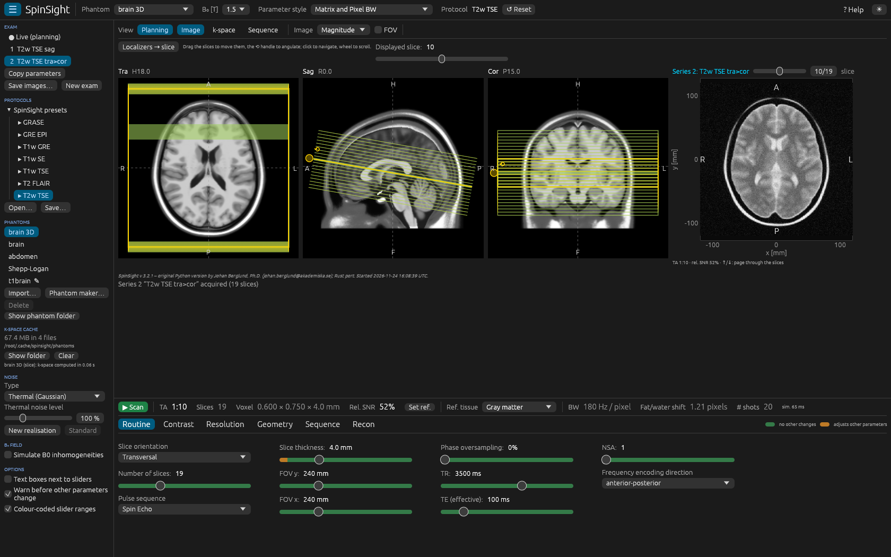
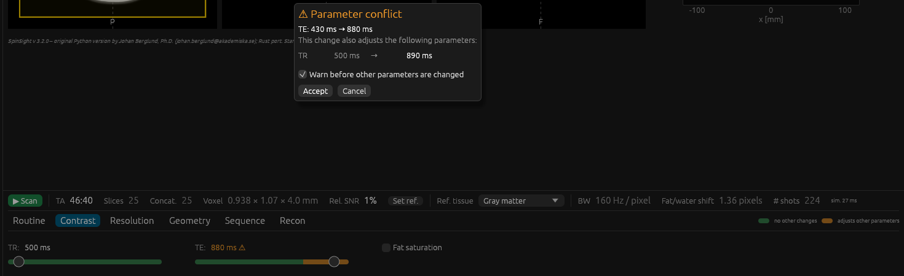
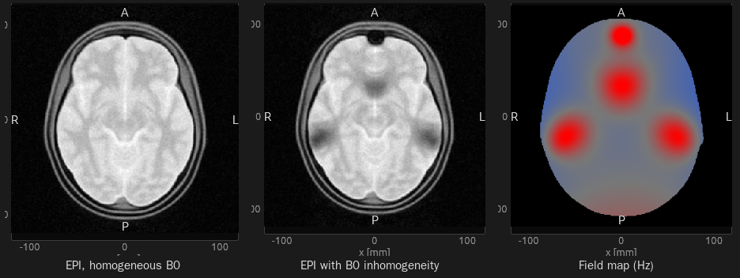

[](https://www.gnu.org/licenses/gpl-3.0)



# SpinSight MRI simulator
SpinSight is an MRI simulator created for educational puposes. It jointly visualizes the imaging parameters, the MRI pulse sequence, the k-space data matrix, and the MR image. These are updated in real-time when the user changes parameters. The data is simulated from computational 2D phantoms in vector graphics format (SVG); the desktop version additionally has a 3D brain phantom on which slices are planned and acquired as in an MR examination.

This repository contains two implementations:

* **SpinSight for desktop (Rust)** – a native application shipped as a single standalone executable for Windows, macOS and Linux, laid out like an MR scanner console, with a 3D brain phantom, slice planning on three localizers, multi-slice scans and a phantom maker. It is a port of the Python simulator and computes the same images, but much faster (see [Performance](#performance)).
* **SpinSight for the web browser (Python)** – the original implementation in [spinsight/](./spinsight), run as a browser dashboard (see [Python version](#python-version)).

## Download (desktop version)
Get the file for your computer from the **[latest release](../../releases/latest)** – nothing to install:

| Computer | File | How to start |
|---|---|---|
| Windows 10/11 (64-bit) | `SpinSight-windows-x64.exe` | Double-click. SmartScreen may warn about an unknown publisher: *More info → Run anyway*. |
| macOS 11+ (Apple Silicon and Intel) | `SpinSight-macos-universal.zip` | Unzip and move *SpinSight.app* to *Applications*. The app is not notarised: the first time, right-click → *Open*. |
| Linux x86-64 | `SpinSight-linux-x86_64.tar.gz` | `tar xzf SpinSight-linux-x86_64.tar.gz && ./SpinSight-linux-x86_64/spinsight` |

### Using the desktop version
The window is organised like the console of an MR scanner:

* **Exam bar** (top): phantom ("patient"), field strength, parameter style (how resolution and bandwidth are entered, as on scanners of different vendors), the loaded protocol with **↺ Reset**, help mode and light/dark theme.
* **Browser** (left, **☰**): the examination (acquired series, see below), protocols (presets; open/save protocol files in TOML, compatible with the Python version for 2D phantoms), phantoms (import, phantom maker, delete own phantoms), the k-space cache, the noise settings and options.
* **Viewing** (centre): slice planning (3D phantom), MR image, k-space and pulse sequence diagram, each switchable. Hover a gradient, RF pulse or sampling window in the sequence diagram to see its properties and its path in k-space.
* **Parameter card** (bottom) with the tabs *Routine*, *Contrast*, *Resolution*, *Geometry*, *Sequence* and *Recon*, and the status line with the **▶ Scan** button, acquisition time (TA), number of slices and concatenations, voxel size, relative SNR, bandwidth, fat/water shift and number of shots.

Help mode (**? Help**) provides explanations of each parameter; hovering TE, TR or TI highlights the interval in the pulse sequence diagram.

The program starts with the **standard protocol**, a T1-weighted spin echo (TR 500 ms, minimum TE, 256 × 224 matrix, 4 mm slices). **↺ Reset** returns all parameters to it – protocol, field of view, slice position, noise and display settings; the phantom and the acquired series are kept. It is also listed as preset *T1w SE*.

### Parameter conflicts
As on MR scanners, a change of one parameter can require changes of others – a longer TE needs a longer TR, a larger matrix or a lower bandwidth a longer TE, a higher turbo factor a longer TR, thin slices a longer TE:
* **Colour-coded sliders**: the rail of each slider shows in green the values that change no other parameter and in orange the values for which other parameters are adjusted. The sliders are extended by these orange values (beyond the range that fits the current protocol); hovering an orange value shows what would change (e.g. *750 ms: TR 500 ms → 760 ms*).
* **Warning before the change** (option *Warn before other parameters change*, on by default): the sliders move freely. While a slider is in the orange range, its value is shown in orange (⚠) but not applied – the image keeps the last valid state. When the slider is released there, a dialog lists the parameters that would be adjusted, with their old and new values; *Accept* (Enter) makes the change, *Cancel* (Esc) returns to the last valid value. Released in the green range, the value is applied directly. Accepted adjustments stay (a TR prolonged for a long TE is not shortened again automatically). Changes in selection lists and text boxes are confirmed the same way. With the option off, the adjustments are made directly.

Both can be switched off under *OPTIONS* in the browser.



### Noise
The *NOISE* section of the browser sets the kind and strength of the noise:
* **Type**: *Thermal (Gaussian)* – the white complex Gaussian noise of receiver and patient (Rician in magnitude images); *+ spikes* – a few corrupted k-space samples causing a striped herringbone pattern; *+ RF interference* – an external radio frequency picked up in every readout, causing a dotted zipper line along the phase encoding direction; or both.
* **Thermal noise level** (0–400 % of the standard; 0 % is noise-free) – the relative SNR changes accordingly – and the **strength** of spikes / RF interference.
* **New realisation** draws new random noise, spike positions and interference frequency; **Standard** returns to thermal noise at 100 %.

### B0 inhomogeneity
The *B₀ FIELD* section below it switches on the simulation of **B0 inhomogeneities** (off by default):
* **Field**: for the 3D brain, the off-resonance is computed from the magnetic susceptibility of the air in the paranasal sinuses, mastoid cells and ear canals (found in the volume; Δχ = 9.4 ppm relative to tissue), as the dipole field with B0 along the head–feet axis of a cylindrical bore. The second-order **shim** (on by default) removes the smooth part of the field over the brain, as the scanner's automatic shim does; without it, the field also varies smoothly over the whole head. 2D phantoms get a generic field. The **strength** (0–300 %) scales the susceptibility; the field scales with B0 (3 T doubles it). **Show field map** displays the off-resonance [Hz] of the slice instead of the MR image.
* **Effects** (simulated from the timing of every k-space sample): geometric distortion along the frequency encoding direction and, much stronger, along the phase encoding direction in EPI; signal loss in gradient echoes from dephasing within the voxels and across the slice, growing with TE and B0 (spin echoes refocus it at the echo); failure of the frequency-selective fat saturation near the air cavities (and saturation of shifted water); ghosting in segmented EPI.
* **Method**: the phase until the echo time is applied to the tissue images exactly; the phase evolution during the readouts is described by off-resonance frequency bins with least-squares (time-segmentation) interpolators; voxels whose local echo is shifted out of the sampled k-space by the field gradient lose their signal. With the B0 simulation on, a new image takes about 0.1–0.6 s instead of 0.02–0.1 s.



### 3D brain phantom: slice planning and examinations
The default phantom, **brain 3D**, is a complete head volume (1 mm voxels, 189 × 220 × 184 mm): gray matter, white matter and CSF of the brain, and fat, muscle and bone/air of the head around it. It is derived from the MNI ICBM 152 2009c template (see [License](#license)); [tools/make_brain3d.py](./tools/make_brain3d.py) rebuilds it from the template files. Every slice is computed from the volume with its real thickness (partial volume of tissues over the slice profile), at any position and angulation.

1. **Plan** – the *Planning* view shows three localizers (transversal, sagittal, coronal) with the planned slice stack in yellow, as on a scanner:
   * drag the slices to move the stack, drag the **⟲** handle to angulate it (e.g. *Tra>Cor* to align transversal slices with the AC–PC line);
   * click into a localizer to show that point in the other two, scroll with the mouse wheel through the localizer planes;
   * the highlighted slice is the *displayed slice*, simulated live as MR image (with orientation labels A/P, R/L, H/F); the filled band marks exactly where it cuts each localizer image;
   * *Routine* and *Geometry* tabs: slice orientation, angulations, position R/L, A/P, H/F, number of slices, distance factor (gap) and slice thickness.
2. **Scan** – **▶ Scan** acquires all slices of the stack as a new series (each slice with its own noise; 25 slices take 1–2 s). The scan time (TA) accounts for multi-slice interleaving: as many slices as fit into TR are acquired together, more slices need *concatenations*, which multiply TA. With inversion recovery (FLAIR), slices are inverted interleaved.
3. **Review** – the series appear in the *EXAM* list of the browser. Selecting one shows its images (slice slider, ↑/↓ keys) and its slices in cyan in the localizers. *Copy parameters* loads the protocol and slice position of a series (to repeat or modify it), *Save images…* writes the series as PNG files, *New exam* clears the list. *Live (planning)* returns to the live image of the current protocol.

So a complete examination can be re-enacted, for example: a sagittal T2w TSE, then transversal T2w TSE and FLAIR angulated along the AC–PC line on it, then a coronal T1w – and the images compared side by side with the effects of TR, TE, TI, resolution, bandwidth or slice thickness.

The 2D phantoms (*brain*, *abdomen*, *Shepp-Logan* and own phantoms) work as before (one slice, identical results to the Python version).

### Own phantoms: import and phantom maker
* **Import…** (or drop a file onto the window) accepts an SVG drawing (a dialog asks which tissue each fill colour is, unless a `.toml` colormap lies next to it), a TOML ellipse phantom, a PNG label image with its colormap, or any image (PNG, JPEG, TIFF, BMP, …), which opens in the phantom maker.
* **Phantom maker…** makes a phantom from an image and/or drawn shapes:
  1. *Image (optional)* – the image is segmented into 2–8 intensity classes (k-means on the gray levels, with optional smoothing); choose the tissue of each class (the darkest class is background by default) and the physical image width.
  2. *Draw shapes* – ellipses, rectangles and polygons with a tissue (or the eraser), painted on top of the image in the order of the shape list; shapes can be selected, moved, reordered and deleted.
  3. *Save* – stores the phantom as a label image; *Save and use* switches to it right away.


Own phantoms are marked with ✎ in the phantom list and can be deleted there; **Show phantom folder** opens the folder in the file manager.

### Where files are stored
| | macOS | Windows | Linux |
|---|---|---|---|
| Own phantoms | `~/Library/Application Support/se.uu.SpinSight/phantoms` | `%APPDATA%\uu\SpinSight\data\phantoms` | `~/.local/share/spinsight/phantoms` |
| k-space cache | `~/Library/Caches/se.uu.SpinSight/phantoms` | `%LOCALAPPDATA%\uu\SpinSight\cache\phantoms` | `~/.cache/spinsight/phantoms` |

The cache holds the computed k-space of each phantom that has been opened (single precision): about 7 MB for *brain*, 53 MB for *abdomen* and 5 MB for *Shepp-Logan*. The browser shows its size and has buttons to open the folder and to clear it; files of older versions are removed automatically. Without cache the k-space is simply recomputed (0.1–2 s).

### Command line options
```
spinsight [OPTIONS]
    -m, --mode <dark|light>       GUI theme (default: follow the system)
    -s, --settingsFile <FILE>     settings file (.toml) to load at startup
    -t, --slidersWithText         add text boxes next to sliders
        --show-sequence           show the pulse sequence diagram at startup
        --show-kspace             show k-space at startup
        --help-mode               start in help mode
        --set <name=value>        set a parameter at startup (repeatable), e.g. --set TE=80
        --phantom-maker [IMAGE]   open the phantom maker at startup (optionally with an image)
        --import <FILE>           import a phantom file (.svg with .toml colormap, .toml, label .png) and exit
        --export <FILE.png>       render the MR image to a PNG file and exit (no GUI)
        --export-kspace <FILE>    also write the k-space display to a PNG file
        --scan <DIR>              3D phantom: acquire all planned slices and write them as PNG
                                  files to DIR (no GUI)
        --benchmark               print computation times and exit
```
Without `--set load_presets=…` or a settings file, the standard protocol (T1w SE) is used. Example: `spinsight --set load_presets=T2-FLAIR --set object=abdomen --export flair.png` renders an image without opening a window, and `spinsight --set load_presets=T1w-TSE --set slice_orientation=Coronal --set num_slices=20 --scan exam` acquires 20 coronal T1w slices of the 3D phantom into the folder `exam`.

## Performance
The desktop version is a faithful port of the Python computation graph: the same sequence timing and parameter bounds, the same analytic phantom k-space, and the same reconstruction. The test suite cross-validates it against values computed with the Python version (protocol values agree to 10⁻⁹, Cartesian images to 10⁻¹², radial images to about 10⁻⁵, limited by the NUFFT accuracy). Measured on the same 4-core machine:

| Computation | Python | Rust |
|---|---:|---:|
| Phantom k-space, brain (first-time loading) | 40.9 s | 0.6 s |
| Phantom k-space, abdomen (first-time loading) | 30.7 s | 1.8 s |
| Image, default spin echo | 0.27 s | 0.02 s |
| Image, abdomen turbo spin echo | 0.75 s | 0.08 s |
| Image, radial | 3.8 s | 0.11 s |
| Image, PROPELLER | 4.7 s | 0.14 s |
| Slice of the 3D phantom (new position or angulation, incl. image) | – | 0.06–0.1 s |
| Multi-slice scan, 25 slices T2w TSE (3D phantom) | – | 1.9 s |

The Python times exclude the time needed to render the browser dashboard. In the desktop version, changing contrast parameters (TE, TR, flip angle, …) re-uses the cached k-space and takes 6–20 ms, so images update continuously while a slider is dragged. Phantom k-space is cached on disk after the first computation.

How the speed-up was achieved:
* polygon Fourier transforms are evaluated with a separable vertex formulation (no trigonometric functions per grid point and edge), in parallel over all shapes;
* sinc interpolation uses optimized matrix multiplication; FFTs use [RustFFT](https://crates.io/crates/rustfft);
* radial/PROPELLER gridding uses a built-in 2D non-uniform FFT (exponential-of-semicircle kernel, as in FINUFFT) with Voronoi density compensation computed from a Delaunay triangulation;
* intermediate results (resampled phantom k-space, gridding operator, noise) are cached and the simulation runs in a background thread.

## Building the desktop version from source
Install [Rust](https://rustup.rs) (1.95 or newer), then
```
cargo run --release
```
No other libraries are needed for building. On Linux the program needs X11 or Wayland with OpenGL at runtime. Run the tests with `cargo test --release`; with the environment variable `SPINSIGHT_PYREF` pointing to raw arrays dumped from the Python version, `tests/reference_images.rs` additionally compares phantom k-space and images.

The release workflow ([.github/workflows/release.yml](./.github/workflows/release.yml)) builds the executables for all platforms on every push; pushing a tag `v*`, pushing to `main`, or pushing a commit whose message contains `[release]` publishes them as the GitHub release `v<version>` (version from `Cargo.toml`).

### Source overview
| Module | Python counterpart | Content |
|---|---|---|
| `src/protocol.rs` | `nodes/*` (scalar part), `sequence.py` | derived parameters, pulse sequence timing, parameter bounds, SNR, scan time |
| `src/imaging.rs` | `nodes/kspace_simulation.py`, `kspace_processing.py`, `image_reconstruction.py` | k-space sampling, contrast, noise, homodyne, apodization, zero filling, reconstruction |
| `src/phantom.rs`, `src/svg.rs` | `phantom.py` | phantom shapes (incl. label images) and analytic k-space |
| `src/volume.rs`, `src/geometry.rs` | – | 3D phantom (sampling, slices with thickness), slice geometry (orientation, angulation, stack) |
| `src/b0.rs` | – | B0 field of air cavities (susceptibility, dipole FFT, shim), off-resonance bins for the simulation |
| `src/exam.rs` | – | multi-slice acquisition of the planned stack into series |
| `src/phantom_maker.rs` | – | segmentation, drawn shapes, phantom import |
| `src/nufft.rs`, `src/voronoi.rs` | `recon.py` (finufft / mri-nufft) | non-Cartesian gridding |
| `src/controller.rs` | `controller.py` | parameter styles, bounds, visibility, presets, settings files, parameter conflicts (preview, extended slider ranges), reset |
| `src/gui/` | `gui.py`, `nodes/*_plot.py` | the egui user interface (`planning.rs`: localizers and slice planning, `exam_ui.rs`: scan and series, `conflicts.rs`: colour-coded slider ranges and conflict dialog, `maker.rs`: phantom maker window) |

## Phantom construction
To create a new phantom, add a directory with the phantom name containing files with the same name as the directory. For the Python version, the directory goes under [spinsight/phantoms](./spinsight/phantoms). The desktop version has the built-in phantoms compiled in and reads additional phantoms from a `phantoms` folder next to the executable, from the folder given by the environment variable `SPINSIGHT_PHANTOMS`, or from `phantoms` in the SpinSight data directory (`~/.local/share/spinsight` on Linux, `~/Library/Application Support/se.uu.SpinSight` on macOS, `%APPDATA%\uu\SpinSight\data` on Windows). Two formats are supported:

### A single `.toml` file
The file shall consist of a list of shapes (see [Shepp-Logan_shapes.toml](./spinsight/phantoms/Shepp-Logan/Shepp-Logan.toml) for reference). Each shape is assigned a tissue type which must be defined in the `TISSUES` dict in [constants.py](./spinsight/constants.py) (`TISSUES` in [src/constants.rs](./src/constants.rs) for the desktop version).

### A pair of `.toml` and `.svg` files
The `.toml` file specifies a mapping from hexcolors to tissues (see [brain.toml](./spinsight/phantoms/brain/brain.toml) for reference). The tissues must be defined in the `TISSUES` dict in [constants.py](./spinsight/constants.py) (`TISSUES` in [src/constants.rs](./src/constants.rs) for the desktop version).

The specified `.svg` file must meet the following specifications:
* All paths must be closed
* All paths must have a fill color matching a hexcolor defined in the `.toml` file (this defines the tissue).
* Only polygons are supported (not Bézier curves etc.)

### A pair of `.png` and `.toml` files (desktop version only)
A label image: every pixel colour listed in the `.toml` file is a tissue, all other colours are background. The `.toml` file also gives the pixel size in mm:
```toml
pixel_size = 0.5
'#00ff00' = 'Gray matter'
'#d40000' = 'White matter'
'#00ffff' = 'CSF'
```
The k-space of such a phantom is computed exactly for square pixels. The phantom maker saves its phantoms in this format.

## Python version
Install using pip:
```
pip install spinsight
```
Then run as a command line tool
```
spinsight
```
This serves SpinSight on the local host, so that the simulator can be run by navigating to [localhost](http://localhost) in the web browser. The same command line tool can be used to deploy the simulator on a local network, or on a web server (run `spinsight -h` for help). Be aware that several minutes are required upon loading a phantom for the first time.

Help mode can be enabled in the sidebar menu, to provide explanations of each parameter.

### Dependencies
See [pyproject.toml](./pyproject.toml), *dependencies* under heading **[project]**. The desktop version's dependencies are listed in [Cargo.toml](./Cargo.toml).

## How to cite
If you use this software in your research, please cite:

> Berglund J, Jain K, Sousa JM, Hedman K, Fahlström M. “SpinSight – An educational open-source MRI simulator with joint visualization of pulse sequence, k-space, and MR image. In: *Proceedings of the Annual Meeting of the International Society of Magnetic Resonance in Medicine*, Honolulu 2025, pp. 1968.

## License
SpinSight is distributed under the terms of the GNU General Public License. See [LICENSE.md](./LICENSE.md). The desktop version bundles the DejaVu Sans font ([license](./assets/fonts/LICENSE-DejaVu.txt)).

The 3D brain phantom is derived from the ICBM 152 Nonlinear Asymmetrical template 2009c (MNI152NLin2009cAsym, obtained via [TemplateFlow](https://www.templateflow.org)), Copyright © 1993–2004 Louis Collins, McConnell Brain Imaging Centre, Montreal Neurological Institute, McGill University, distributed under a permissive license ([details and references](./assets/volumes/LICENSE-MNI.txt)): Fonov VS, Evans AC, McKinstry RC, Almli CR, Collins DL. *Unbiased nonlinear average age-appropriate brain templates from birth to adulthood.* NeuroImage 2009;47:S102. Fonov V et al. *Unbiased average age-appropriate atlases for pediatric studies.* NeuroImage 2011;54(1):313–327. As an average of many subjects, the template is smoother than a single brain, and the head ends below the cerebellum.

## Contact Information
Johan Berglund, Ph.D.  
Uppsala University Hospital,  
Uppsala, Sweden  
johan.berglund@akademiska.se

---
Copyright © 2021–2026 Johan Berglund.
