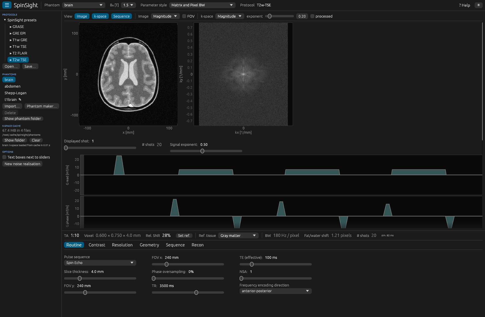
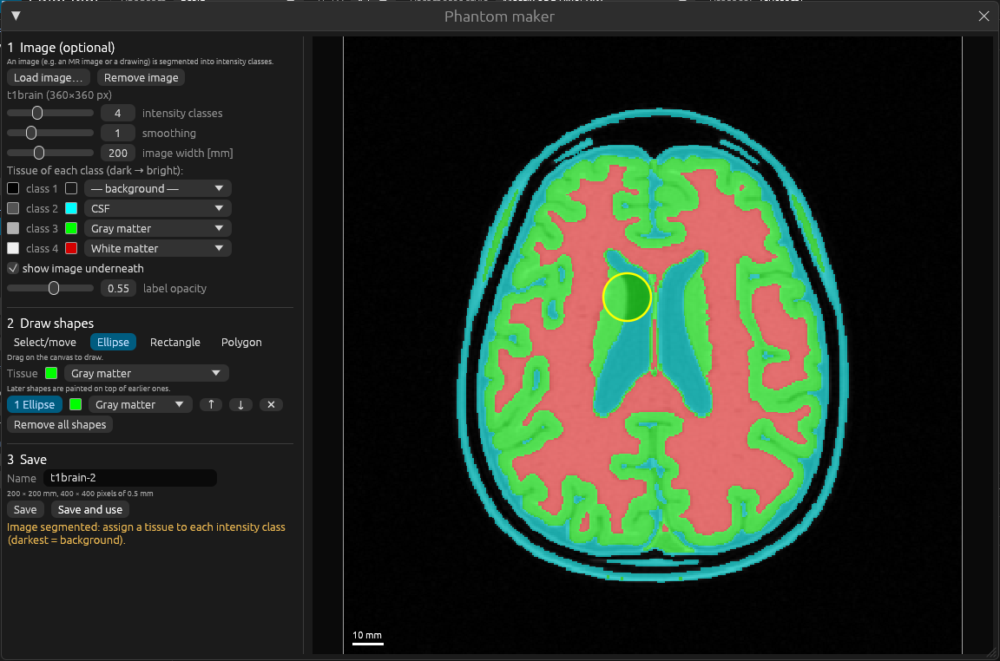

[](https://www.gnu.org/licenses/gpl-3.0)



# SpinSight MRI simulator
SpinSight is an MRI simulator created for educational puposes. It jointly visualizes the imaging parameters, the MRI pulse sequence, the k-space data matrix, and the MR image. These are updated in real-time when the user changes parameters. The data is simulated from computational 2D phantoms in vector graphics format (SVG).

This repository contains two implementations:

* **SpinSight for desktop (Rust)** – a native application shipped as a single standalone executable for Windows, macOS and Linux, laid out like an MR scanner console and with a phantom maker. It is a port of the Python simulator and computes the same images, but much faster (see [Performance](#performance)).
* **SpinSight for the web browser (Python)** – the original implementation in [spinsight/](./spinsight), run as a browser dashboard (see [Python version](#python-version)).

## Download (desktop version)
Get the file for your computer from the **[latest release](../../releases/latest)** – nothing to install:

| Computer | File | How to start |
|---|---|---|
| Windows 10/11 (64-bit) | `SpinSight-windows-x64.exe` | Double-click. SmartScreen may warn about an unknown publisher: *More info → Run anyway*. |
| macOS 11+ (Apple Silicon and Intel) | `SpinSight-macos-universal.zip` | Unzip and move *SpinSight.app* to *Applications*. The app is not notarised: the first time, right-click → *Open*. |
| Linux x86-64 | `SpinSight-linux-x86_64.tar.gz` | `tar xzf SpinSight-linux-x86_64.tar.gz && ./SpinSight-linux-x86_64/spinsight` |

### Using the desktop version
The window is organised like the console of an MR scanner:

* **Exam bar** (top): phantom ("patient"), field strength, parameter style (how resolution and bandwidth are entered, as on scanners of different vendors), the loaded protocol, help mode and light/dark theme.
* **Browser** (left, **☰**): protocols (presets; open/save protocol files in TOML, compatible with the Python version), phantoms (import, phantom maker, delete own phantoms) and the k-space cache.
* **Viewing** (centre): MR image, k-space and pulse sequence diagram, each switchable. Hover a gradient, RF pulse or sampling window in the sequence diagram to see its properties and its path in k-space.
* **Parameter card** (bottom) with the tabs *Routine*, *Contrast*, *Resolution*, *Geometry*, *Sequence* and *Recon*, and the status line with acquisition time (TA), voxel size, relative SNR, bandwidth, fat/water shift and number of shots.

Help mode (**? Help**) provides explanations of each parameter; hovering TE, TR or TI highlights the interval in the pulse sequence diagram.

### Own phantoms: import and phantom maker
* **Import…** (or drop a file onto the window) accepts an SVG drawing (a dialog asks which tissue each fill colour is, unless a `.toml` colormap lies next to it), a TOML ellipse phantom, a PNG label image with its colormap, or any image (PNG, JPEG, TIFF, BMP, …), which opens in the phantom maker.
* **Phantom maker…** makes a phantom from an image and/or drawn shapes:
  1. *Image (optional)* – the image is segmented into 2–8 intensity classes (k-means on the gray levels, with optional smoothing); choose the tissue of each class (the darkest class is background by default) and the physical image width.
  2. *Draw shapes* – ellipses, rectangles and polygons with a tissue (or the eraser), painted on top of the image in the order of the shape list; shapes can be selected, moved, reordered and deleted.
  3. *Save* – stores the phantom as a label image; *Save and use* switches to it right away.



Own phantoms are marked with ✎ in the phantom list and can be deleted there; **Show phantom folder** opens the folder in the file manager.

### Where files are stored
| | macOS | Windows | Linux |
|---|---|---|---|
| Own phantoms | `~/Library/Application Support/se.uu.SpinSight/phantoms` | `%APPDATA%\uu\SpinSight\data\phantoms` | `~/.local/share/spinsight/phantoms` |
| k-space cache | `~/Library/Caches/se.uu.SpinSight/phantoms` | `%LOCALAPPDATA%\uu\SpinSight\cache\phantoms` | `~/.cache/spinsight/phantoms` |

The cache holds the computed k-space of each phantom that has been opened (single precision): about 7 MB for *brain*, 53 MB for *abdomen* and 5 MB for *Shepp-Logan*. The browser shows its size and has buttons to open the folder and to clear it; files of older versions are removed automatically. Without cache the k-space is simply recomputed (0.1–2 s).

### Command line options
```
spinsight [OPTIONS]
    -m, --mode <dark|light>       GUI theme (default: follow the system)
    -s, --settingsFile <FILE>     settings file (.toml) to load at startup
    -t, --slidersWithText         add text boxes next to sliders
        --show-sequence           show the pulse sequence diagram at startup
        --show-kspace             show k-space at startup
        --help-mode               start in help mode
        --set <name=value>        set a parameter at startup (repeatable), e.g. --set TE=80
        --phantom-maker [IMAGE]   open the phantom maker at startup (optionally with an image)
        --import <FILE>           import a phantom file (.svg with .toml colormap, .toml, label .png) and exit
        --export <FILE.png>       render the MR image to a PNG file and exit (no GUI)
        --export-kspace <FILE>    also write the k-space display to a PNG file
        --benchmark               print computation times and exit
```
Example: `spinsight --set load_presets=T2-FLAIR --set object=abdomen --export flair.png` renders an image without opening a window.

## Performance
The desktop version is a faithful port of the Python computation graph: the same sequence timing and parameter bounds, the same analytic phantom k-space, and the same reconstruction. The test suite cross-validates it against values computed with the Python version (protocol values agree to 10⁻⁹, Cartesian images to 10⁻¹², radial images to about 10⁻⁵, limited by the NUFFT accuracy). Measured on the same 4-core machine:

| Computation | Python | Rust |
|---|---:|---:|
| Phantom k-space, brain (first-time loading) | 40.9 s | 0.6 s |
| Phantom k-space, abdomen (first-time loading) | 30.7 s | 1.8 s |
| Image, default spin echo | 0.27 s | 0.02 s |
| Image, abdomen turbo spin echo | 0.75 s | 0.08 s |
| Image, radial | 3.8 s | 0.11 s |
| Image, PROPELLER | 4.7 s | 0.14 s |

The Python times exclude the time needed to render the browser dashboard. In the desktop version, changing contrast parameters (TE, TR, flip angle, …) re-uses the cached k-space and takes 6–20 ms, so images update continuously while a slider is dragged. Phantom k-space is cached on disk after the first computation.

How the speed-up was achieved:
* polygon Fourier transforms are evaluated with a separable vertex formulation (no trigonometric functions per grid point and edge), in parallel over all shapes;
* sinc interpolation uses optimized matrix multiplication; FFTs use [RustFFT](https://crates.io/crates/rustfft);
* radial/PROPELLER gridding uses a built-in 2D non-uniform FFT (exponential-of-semicircle kernel, as in FINUFFT) with Voronoi density compensation computed from a Delaunay triangulation;
* intermediate results (resampled phantom k-space, gridding operator, noise) are cached and the simulation runs in a background thread.

## Building the desktop version from source
Install [Rust](https://rustup.rs) (1.95 or newer), then
```
cargo run --release
```
No other libraries are needed for building. On Linux the program needs X11 or Wayland with OpenGL at runtime. Run the tests with `cargo test --release`; with the environment variable `SPINSIGHT_PYREF` pointing to raw arrays dumped from the Python version, `tests/reference_images.rs` additionally compares phantom k-space and images.

The release workflow ([.github/workflows/release.yml](./.github/workflows/release.yml)) builds the executables for all platforms on every push; pushing a tag `v*`, pushing to `main`, or pushing a commit whose message contains `[release]` publishes them as the GitHub release `v<version>` (version from `Cargo.toml`).

### Source overview
| Module | Python counterpart | Content |
|---|---|---|
| `src/protocol.rs` | `nodes/*` (scalar part), `sequence.py` | derived parameters, pulse sequence timing, parameter bounds, SNR, scan time |
| `src/imaging.rs` | `nodes/kspace_simulation.py`, `kspace_processing.py`, `image_reconstruction.py` | k-space sampling, contrast, noise, homodyne, apodization, zero filling, reconstruction |
| `src/phantom.rs`, `src/svg.rs` | `phantom.py` | phantom shapes (incl. label images) and analytic k-space |
| `src/phantom_maker.rs` | – | segmentation, drawn shapes, phantom import |
| `src/nufft.rs`, `src/voronoi.rs` | `recon.py` (finufft / mri-nufft) | non-Cartesian gridding |
| `src/controller.rs` | `controller.py` | parameter styles, bounds, visibility, presets, settings files |
| `src/gui/` | `gui.py`, `nodes/*_plot.py` | the egui user interface (`maker.rs`: phantom maker window) |

## Phantom construction
To create a new phantom, add a directory with the phantom name containing files with the same name as the directory. For the Python version, the directory goes under [spinsight/phantoms](./spinsight/phantoms). The desktop version has the built-in phantoms compiled in and reads additional phantoms from a `phantoms` folder next to the executable, from the folder given by the environment variable `SPINSIGHT_PHANTOMS`, or from `phantoms` in the SpinSight data directory (`~/.local/share/spinsight` on Linux, `~/Library/Application Support/se.uu.SpinSight` on macOS, `%APPDATA%\uu\SpinSight\data` on Windows). Two formats are supported:

### A single `.toml` file
The file shall consist of a list of shapes (see [Shepp-Logan_shapes.toml](./spinsight/phantoms/Shepp-Logan/Shepp-Logan.toml) for reference). Each shape is assigned a tissue type which must be defined in the `TISSUES` dict in [constants.py](./spinsight/constants.py) (`TISSUES` in [src/constants.rs](./src/constants.rs) for the desktop version).

### A pair of `.toml` and `.svg` files
The `.toml` file specifies a mapping from hexcolors to tissues (see [brain.toml](./spinsight/phantoms/brain/brain.toml) for reference). The tissues must be defined in the `TISSUES` dict in [constants.py](./spinsight/constants.py) (`TISSUES` in [src/constants.rs](./src/constants.rs) for the desktop version).

The specified `.svg` file must meet the following specifications:
* All paths must be closed
* All paths must have a fill color matching a hexcolor defined in the `.toml` file (this defines the tissue).
* Only polygons are supported (not Bézier curves etc.)

### A pair of `.png` and `.toml` files (desktop version only)
A label image: every pixel colour listed in the `.toml` file is a tissue, all other colours are background. The `.toml` file also gives the pixel size in mm:
```toml
pixel_size = 0.5
'#00ff00' = 'Gray matter'
'#d40000' = 'White matter'
'#00ffff' = 'CSF'
```
The k-space of such a phantom is computed exactly for square pixels. The phantom maker saves its phantoms in this format.

## Python version
Install using pip:
```
pip install spinsight
```
Then run as a command line tool
```
spinsight
```
This serves SpinSight on the local host, so that the simulator can be run by navigating to [localhost](http://localhost) in the web browser. The same command line tool can be used to deploy the simulator on a local network, or on a web server (run `spinsight -h` for help). Be aware that several minutes are required upon loading a phantom for the first time.

Help mode can be enabled in the sidebar menu, to provide explanations of each parameter.

### Dependencies
See [pyproject.toml](./pyproject.toml), *dependencies* under heading **[project]**. The desktop version's dependencies are listed in [Cargo.toml](./Cargo.toml).

## How to cite
If you use this software in your research, please cite:

> Berglund J, Jain K, Sousa JM, Hedman K, Fahlström M. “SpinSight – An educational open-source MRI simulator with joint visualization of pulse sequence, k-space, and MR image. In: *Proceedings of the Annual Meeting of the International Society of Magnetic Resonance in Medicine*, Honolulu 2025, pp. 1968.

## License
SpinSight is distributed under the terms of the GNU General Public License. See [LICENSE.md](./LICENSE.md). The desktop version bundles the DejaVu Sans font ([license](./assets/fonts/LICENSE-DejaVu.txt)).

## Contact Information
Johan Berglund, Ph.D.  
Uppsala University Hospital,  
Uppsala, Sweden  
johan.berglund@akademiska.se

---
Copyright © 2021–2026 Johan Berglund.
